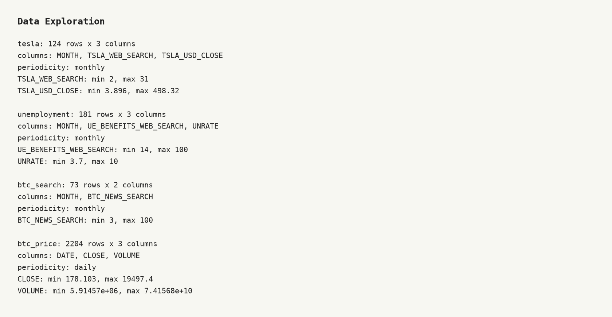
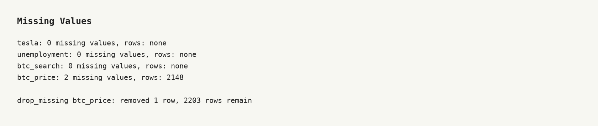
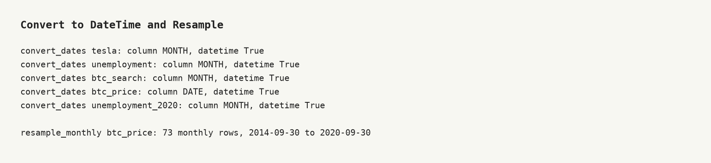
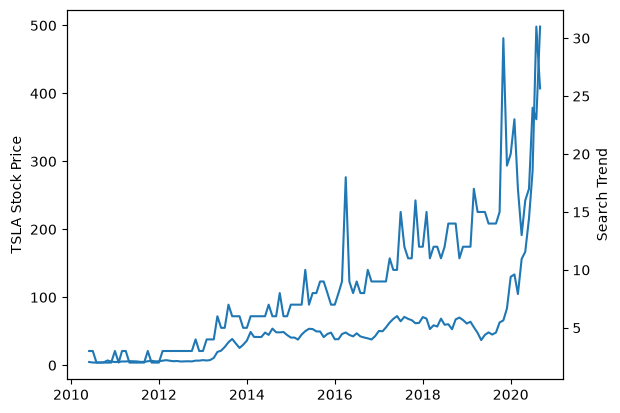
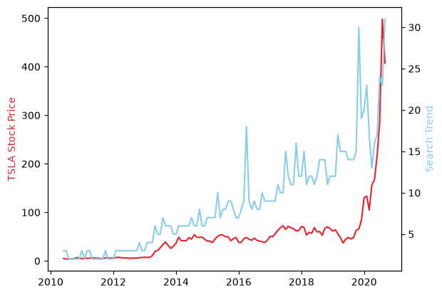
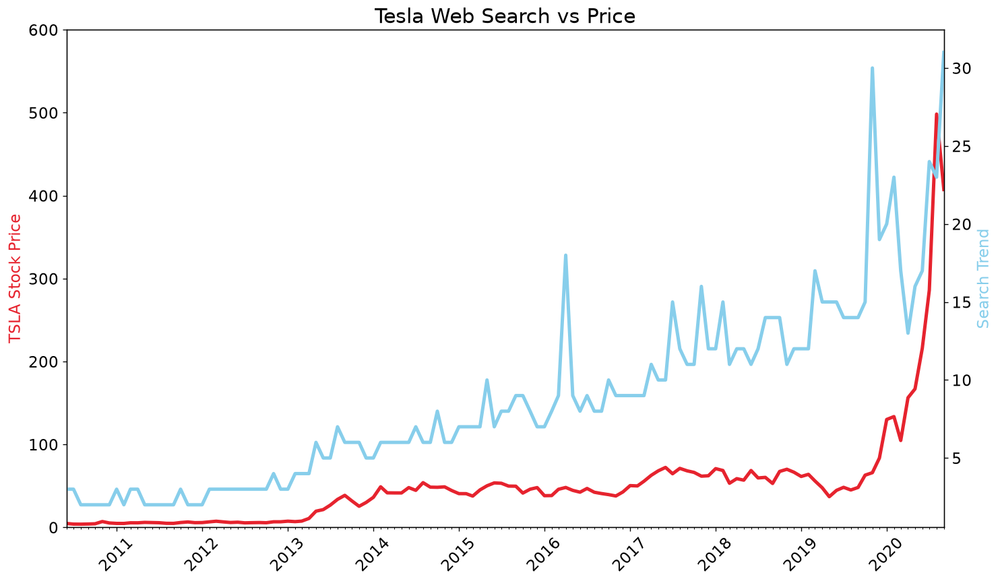
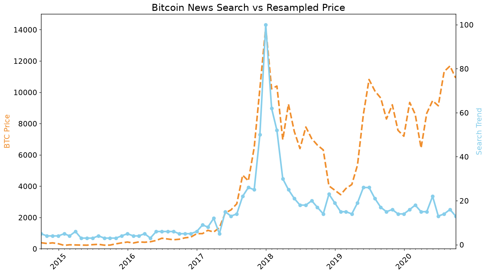
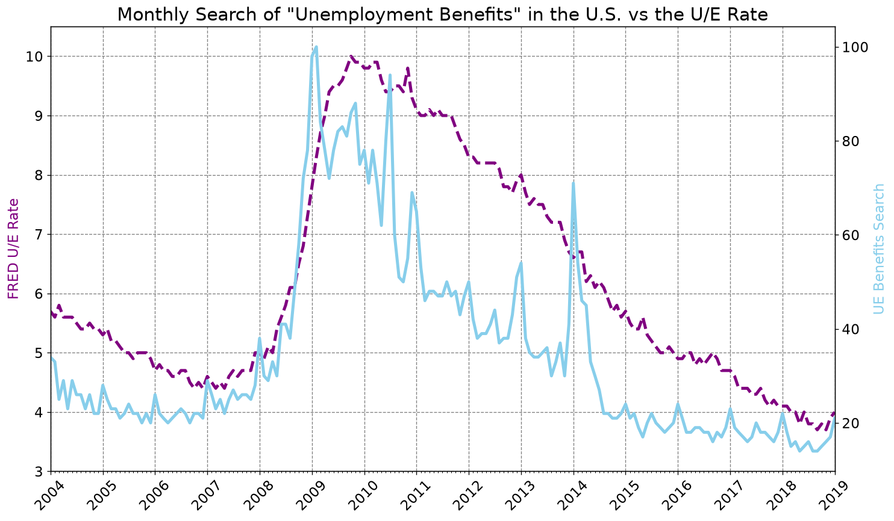
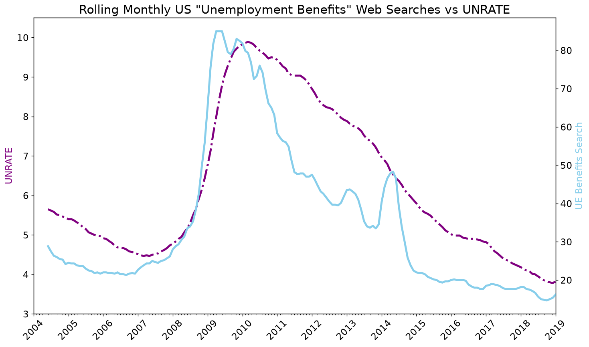
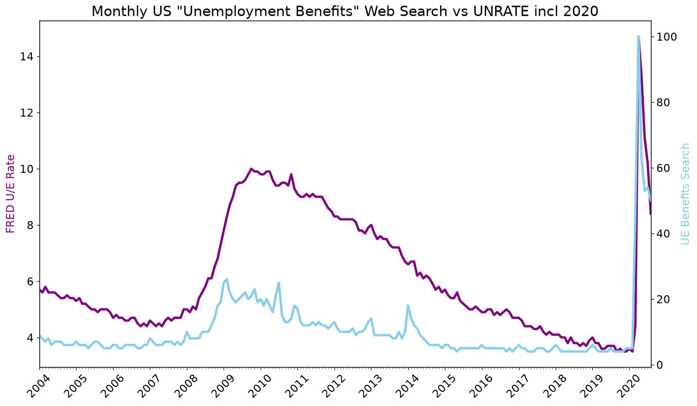

# 🚀 Google Trends Data (Day 75)

Combine Google Trends search interest with Tesla and Bitcoin prices and the US
unemployment rate, as a runnable Python project for the Udemy course
*100 Days of Code: The Complete Python Pro Bootcamp*. It is for fellow
course participants and visitors who want a small, tested pandas and Matplotlib
example.

## 📚 Table of Contents

- [Overview](#-overview)
- [Requirements](#-requirements)
- [Setup](#-setup)
- [Run](#-run)
- [Tests](#-tests)
- [License](#-license)
- [Links](#-links)
- [Appendix: Project documents](#-appendix-project-documents)

## 🧭 Overview

The project follows the lecture of Day 75: explore and clean the data, make
time series comparable by resampling, and draw styled Matplotlib charts.

| Folder | What it holds |
| --- | --- |
| `src/google_trends_data/` | The Python package with the assignment's functions |
| `tests/` | Unit tests (pytest) |
| `data/` | The five course CSV files |
| `notebooks/` | The Jupyter notebook that walks the lecture steps |
| `docs/` | Project documents, screenshots and the wiki sources |

## 📋 Requirements

- Python 3.13 or newer (the project uses `venv`).
- Runtime packages: `pandas` and `matplotlib` (nothing else).
- Development extras: `pytest`, `ruff`, `mypy` and `jupyter`.

## 🛠️ Setup

Create and use a local virtual environment in `.venv`.

Windows (PowerShell):

```powershell
python -m venv .venv
.\.venv\Scripts\Activate.ps1
python -m pip install --upgrade pip
python -m pip install -e ".[dev]"
```

Linux and macOS:

```bash
python3 -m venv .venv
source .venv/bin/activate
python -m pip install --upgrade pip
python -m pip install -e ".[dev]"
```

Leave the environment with `deactivate`. For runtime packages only, install
with `python -m pip install -e .`.

## ▶️ Run

Start Jupyter and open the notebook:

```bash
jupyter lab notebooks/google_trends.ipynb
```

Use the functions from Python:

```python
from google_trends_data.domain.datasets import DatasetName
from google_trends_data.presentation import (
    convert_dates, count_missing, describe_data, drop_missing,
    format_summary, load_data, resample_monthly,
)

gateway = load_data()                                  # reads data/*.csv
print(format_summary(describe_data(gateway, DatasetName.TESLA)))
print(count_missing(gateway, DatasetName.BTC_PRICE))   # 2 missing values
drop_missing(gateway, DatasetName.BTC_PRICE)
convert_dates(gateway, DatasetName.BTC_PRICE)
print(resample_monthly(gateway))                       # 73 monthly rows
```

The code is layered (`domain`, `application`, `infrastructure`,
`presentation`); pandas is used only in `infrastructure` (see
[ADR-0001](./docs/adr/adr-0001-pandas-in-infrastructure.md)). The CSV files
in `data/` have snake_case names: for example the lecture file
`TESLA Search Trend vs Price.csv` is `tesla_search_trend_vs_price.csv`.

### Lecture steps and screenshots

Create every screenshot with `python -m google_trends_data.presentation.screenshots`. The wiki ([English][wiki], Danish and Bahasa Malaysia) explains what each step teaches.

**Step 1: Data exploration**: Shape, columns, min and max, and the periodicity of each dataset.



**Step 2: Missing values**: `isna()` finds 2 missing Bitcoin prices in one row; `dropna()` removes it.



**Step 3: Datetime and resampling**: `to_datetime`, then daily prices become 73 monthly rows with `resample`.



**Step 4: Tesla basic chart**: Two y axes with `twinx()`.



**Step 5: Colours**: A HEX colour and a named colour.



**Step 6: Size and style**: Figure size, dpi, fonts, rotation, line width and limits.


**Step 7: Time axis locators**: Year and month ticks with `matplotlib.dates`.



**Step 8: Bitcoin**: Dashed line and circle markers on the resampled price.



**Step 9: Unemployment and the grid**: A grey dashed grid shows seasonality.



**Step 10: Rolling average**: A 6-month rolling mean: searches lead the rate.



**Step 11: Including 2020**: The pandemic spike dwarfs 2008.



## 🧪 Tests

```bash
python -m pytest
python -m ruff check .
python -m mypy src tests
```

Before every push, scan the code with opengrep (the project's static
analysis; the binary is installed under `~/.opengrep/cli/latest/`):

```bash
~/.opengrep/cli/latest/opengrep.exe scan --config p/python --error src tests
```

## 📄 License

GNU Affero General Public License v3.0, see [LICENSE](./LICENSE).

## 🔗 Links

- [Repository][repository]
- [Documentation][documentation]
- [Issue tracker][issues]

## 📎 Appendix: Project documents

The documents a newcomer needs, in reading order.

| Document | What it tells you |
| --- | --- |
| [AGENTS.md][agents] | The rules AI agents follow in this repository |
| [Business Case][BC-001] | Why the project exists, its scope and success criteria |
| [Stakeholder Analysis][SA-001] | Who is involved; the stakeholder IDs used for owners and reviewers |
| [Project Plan][PP-001] | The gateways and their schedule |
| [Milestones][milestones] | One document per gateway: Go/No-Go criteria and tasks |
| [Artifact registry][registry] | Where each artifact type lives, the next version, the PO language and domain |
| [Traceability matrix][TM-001] | How the artifacts link and when each was last reviewed |
| [Framework README][framework-readme] | The framework this project uses |
| [Framework changelog][framework-changelog] | What changed in each framework release |

---

[repository]: https://git.tirsystem.com/Tirsvad-Udemy-100-days-of-code/075-google-trends-data
[documentation]: https://git.tirsystem.com/Tirsvad-Udemy-100-days-of-code/075-google-trends-data/wiki
[wiki]: https://git.tirsystem.com/Tirsvad-Udemy-100-days-of-code/075-google-trends-data/wiki
[issues]: https://git.tirsystem.com/Tirsvad-Udemy-100-days-of-code/075-google-trends-data/issues
[agents]: ./AGENTS.md
[BC-001]: ./docs/business-case.md
[SA-001]: ./docs/stakeholder-analysis.md
[PP-001]: ./docs/project-plan.md
[milestones]: ./docs/milestones/
[registry]: ./docs/artifact-registry.md
[TM-001]: ./docs/sqa/traceability-matrix.md
[framework-readme]: ./framework/README.md
[framework-changelog]: ./framework/CHANGELOG.md
