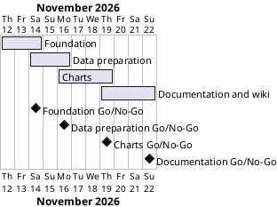

# Project Plan

## Metadata
| Key | Value |
| --- | --- |
| ID | PP-001 |
| CrossReference | [BC-001], [SA-001], [MIL-001], [MIL-002], [MIL-003], [MIL-004] |
| Language | en |
| Domain | it |

## Version History
| Date | Status | Author | Reviewer | Change | Commit |
| --- | --- | --- | --- | --- | --- |
| 2026-11-12 | Accepted | Jens Tirsvad Nielsen | AI as stand-in for S01 | Initial version; Go in RC-003 (autonomous, not independent) | pending |

---

## Purpose

Schedule the four phases that turn the Day 75 assignment into a tested, documented repository. The Business Case sets no fixed deadline; the plan uses short phases of two to three days.

## Planning Assumptions

- Week 1 starts 2026-11-12; the plan ends 2026-11-22.
- Phase length: two to three days; one branch and one pull request per phase.
- No user stories exist: every task is technical (no actor goal), so the Stories column says `none`.
- S01 owns and approves every phase; the AI stands in as reviewer where a review record needs one (autonomous mode, `Mode: autonomous, not independent`).

## Gateway Schedule

| Gateway | Document | Window | Decision date | Owner | Stories | Main deliverable | Milestone |
| --- | --- | --- | --- | --- | --- | --- | --- |
| Foundation | [MIL-001] | 2026-11-12 to 2026-11-14 | 2026-11-14 | S01 | none | pyproject, .gitignore, README skeleton, repo metadata, opengrep | |
| Data preparation | [MIL-002] | 2026-11-14 to 2026-11-16 | 2026-11-16 | S01 | none | load, clean, convert, resample functions with tests | |
| Charts | [MIL-003] | 2026-11-16 to 2026-11-19 | 2026-11-19 | S01 | none | one chart function and PNG per lecture step | |
| Documentation and wiki | [MIL-004] | 2026-11-19 to 2026-11-22 | 2026-11-22 | S01 | none | notebook, README screenshots, wiki en/da/ms | |



## Scope Coverage

| Business Case scope item | Gateway |
| --- | --- |
| Python 3.13, venv, pyproject.toml, .gitignore, opengrep | MIL-001 |
| Loading, exploring and cleaning the CSV files; monthly resampling | MIL-002 |
| Tesla, Bitcoin, unemployment, rolling and 2020 charts | MIL-003 |
| Jupyter notebook, README, unit tests, wiki in en, da, ms | MIL-004 (tests in MIL-001 to MIL-003) |

## Dependencies

```
MIL-001 → MIL-002 → MIL-003 → MIL-004
```

A No-Go on a phase moves every later gateway and the end date by the rework time; S01 decides the new dates and records them in a new Version History row.

## Plan Risks

| Risk | Impact | Mitigation |
| --- | --- | --- |
| Course CSV files are unavailable | MIL-002 blocked | Ask S01 to supply or approve the download before MIL-002 |
| Token scope too narrow for topics or wiki | MIL-001 and MIL-004 blocked | Check scopes at the start of each phase and stop to report |
| Three-language wiki takes longer | MIL-004 slips | Keep pages short; English first |

## Open Issues

- The CSV files must come from the course zip: S01 supplies them or approves the download from the course link.
- The `QC-PP-001` review of this plan is done by S01 accepting it in chat.

---

[BC-001]: ./business-case.md
[SA-001]: ./stakeholder-analysis.md
[MIL-001]: ./milestones/mil-001-foundation.md
[MIL-002]: ./milestones/mil-002-data-preparation.md
[MIL-003]: ./milestones/mil-003-charts.md
[MIL-004]: ./milestones/mil-004-docs-and-wiki.md
